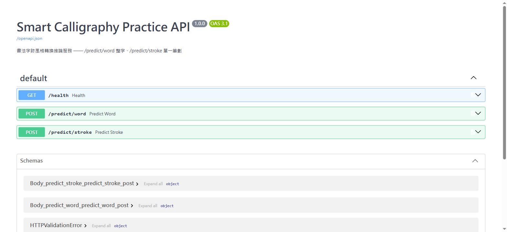

# Smart Calligraphy Practice API

書法字跡風格轉換推論服務——把 zi2zi 條件式 GAN 包裝成 FastAPI，`/predict/word` 處理整字、`/predict/stroke` 處理單一筆劃，GPU 常駐、CPU 備援可切換。

## Live Demo

不用 clone、不用裝 Docker，直接測：

- **`/docs`**：http://136.67.17.108:8080/docs
- **展示用 API Key**（唯讀展示，每個來源 IP 限 10 次/分鐘，額度用完等一分鐘或直接看下面的截圖/自己 clone 跑）：
  ```
  jupd7_Nu3LEj3qJQhJNMt0TzkRHVU10ka4jDss862Js
  ```
  ```bash
  curl -X POST "http://136.67.17.108:8080/predict/word?label=0" \
    -H "X-API-Key: jupd7_Nu3LEj3qJQhJNMt0TzkRHVU10ka4jDss862Js" \
    -F "file=@sample.png;type=image/png"
  ```

服務跑在我自己的 GPU 主機上，透過 [frp](https://github.com/fatedier/frp) 從無公網 IP 的內網環境對外提供（見下方「架構」）。這組 key 是展示用的，會不定期輪替；`/health`、`/docs` 完全不需要 key。

## Demo



<!-- TODO: 換成 /predict/word 上傳一張手寫字、拿到生成結果的 GIF -->

## Quick Start（本機自己跑）

```bash
cp .env.example .env   # 至少把 API_KEY 填一組，見下方「安全性」
docker compose up
open http://localhost:8000/docs
```

需要主機已裝好 NVIDIA 驅動、`nvidia-container-toolkit`（或 Docker Desktop 的 WSL2 GPU 支援）。沒有 GPU 的機器改用：

```bash
docker compose -f docker-compose.yml -f docker-compose.cpu.yml up
```

## API

| Method | Path | 說明 | 需要 API Key |
|---|---|---|---|
| GET | `/health` | 服務與模型載入狀態 | 否 |
| GET | `/docs` | 互動式 API 文件（Swagger UI） | 否 |
| POST | `/predict/word` | 上傳整字圖片，取得風格轉換結果 | 是 |
| POST | `/predict/stroke` | 上傳單一筆劃圖片，取得風格轉換結果 | 是 |

`/predict/*` 回傳的不是分類標籤，是一張重新上色/去背過的筆劃 PNG（base64）加上它在原圖座標系裡的位置——這個模型做的是圖生圖風格轉換，不是分類。

```bash
curl -X POST "http://localhost:8000/predict/word?label=0" \
  -H "X-API-Key: <your-api-key>" \
  -F "file=@sample.png;type=image/png"
```

回應：

```json
{
  "x_position": 128.0,
  "y_position": 127.5,
  "width": 201,
  "height": 201,
  "image_base64": "iVBORw0KGgo...",
  "inference_ms": 32.8
}
```

錯誤情況：檔案不是 `image/jpeg`/`image/png` → 400；超過 5MB → 413；圖片裡偵測不到筆劃 → 400；沒帶或帶錯 `X-API-Key` → 401；超過速率限制 → 429。

## 架構

```
Client → FastAPI (app/main.py)
           ├─ 輸入驗證（content-type / 檔案大小 / 可解析性）
           ├─ API Key 驗證、per-IP 速率限制（slowapi）
           └─ app/inference.py（純函式，不含任何 web 相關程式碼）
                ├─ fitbest()：找筆劃邊界框、置中裁切成正方形
                ├─ Zi2ziModel.forward()（PyTorch，GPU 或 CPU）
                └─ 去背上色、轉 base64 PNG
```

服務啟動時（`lifespan`）把 `word`、`stroke` 兩個模型各載入一次、常駐在記憶體/顯存裡，不是每個請求重新載入——這是 `inference_ms` 這個欄位刻意存在的原因，隨時能看到真實延遲。

## 模型

- 架構：zi2zi（條件式 GAN：UNet Generator + PatchGAN Discriminator），輸入 256×256 灰階圖，`embedding_num=40`、`embedding_dim=128`
- 兩組獨立訓練的 checkpoint：
  - **word**（整字）：epoch 6000，生成品質穩定
  - **stroke**（單一筆劃）：epoch 3000，目前生成結果偏模糊，研判是訓練步數不夠（word 模型到 6000 才穩定），先用著、之後換更好的版本
- 訓練資料筆數、準確率：[待補]
- 推論延遲（GTX 1660 Ti，GPU，容器內實測，各端點 100 次）：

  | 端點 | 平均 | 中位數 | p95 |
  |---|---|---|---|
  | `/predict/word` | 62.7 ms* | 32.8 ms | 45.4 ms |
  | `/predict/stroke` | 30.9 ms | 30.6 ms | 35.4 ms |

  \* 平均被單一次的冷啟動 outlier（~2.75s）拉高——同一個 process 裡第一次真正的 forward pass 會觸發 cuDNN 對這個運算 shape 做一次性演算法搜尋，之後（含 stroke，因為兩個模型 shape 相同、共用 cuDNN 演算法快取）就穩定在 30–45ms。中位數/p95 比平均更能代表穩態延遲。

## 安全性

服務一旦掛上公網，`/predict/*` 一定要設 `API_KEY`（見 `.env.example`），否則任何人都能打你的 GPU。速率限制預設每個來源 IP `10/minute`；透過 frp tcp 模式轉發時，FastAPI 看到的來源 IP 是中繼站的位址而非真實訪客，所以目前這個限制實質上比較接近全域限流，見 `app/config.py` 裡的說明。

## 技術選型說明

- **FastAPI 而不是 Flask**：內建 Pydantic 驗證、自動產生 OpenAPI/Swagger UI（也就是 `/docs`），`async def` 搭配 lifespan 管理模型生命週期不用額外套件。
- **GPU 為主、CPU 為備援，不是兩套程式碼**：`app/inference.py` 的 `load_model()` 只靠一個 `gpu_ids` 參數切換，`model/model.py` 本身已經有 CPU/GPU 兩條分支，靠 `DEVICE` 環境變數 + `docker-compose.cpu.yml` overlay 切換，沒有另外維護一份 CPU-only 分支。
- **word/stroke 是兩個獨立端點，不是同一個端點的參數**：兩個模型的用途、輸出品質、未來的疊代週期都不一樣，做成參數切換只會讓 API 文件跟錯誤處理變得曖昧。

## 開發

```bash
conda create -n smart-calligraphy-api python=3.10 -y
conda activate smart-calligraphy-api
pip install -r requirements-dev.txt   # 含 requirements.txt + pytest/httpx/requests

python -m uvicorn app.main:app --reload --port 8000
pytest tests/
python scripts/bench.py
```

`requirements.txt` 裡的 torch 版本鎖在 `+cu116`，對應這台開發機 `nvidia-smi` 查到的驅動上限（CUDA 11.6）；換一台驅動更新的機器要跟著調整，細節見 `requirements.txt` 裡的註解。
