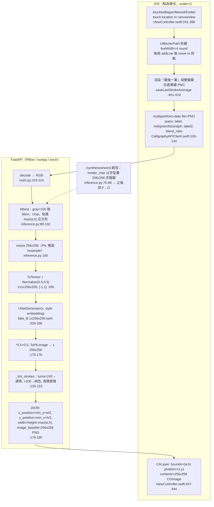

# 01 程式碼閱讀報告：手寫字跡風格轉換專案（只讀、不改）

- 閱讀範圍：`smartCalligraphyPractice`（iOS App，分支 `claude/adoring-darwin-svqr5s`，HEAD `ae7ce1b`）與 `smart-calligraphy-api`（FastAPI 推論服務，同分支，HEAD `bb0866c`）。
- 標示：**[已確認]** 附 檔名:行號；**[量測]** 附腳本路徑與數字；**[推測]** 附依據；**[轉述]** 來自你貼給我的另一個 session 的回報，我沒看到它的腳本／JSON／圖片，未獨立驗證；**未讀**＝沒讀到，不補想像。
- 本報告不提出改進建議，也不判斷兩個痛點的原因。
- 路徑慣例：`API:` 指 `smart-calligraphy-api/`，`iOS:` 指 `smartCalligraphyPractice/smartCalligraphyPractice/`。

> 兩個先講在前面的出入（細節見第 7 章）：
> 1. 你的描述把兩個 repo 都寫成 `smart-calligraphy-api`；實際上 iOS App 在 `smartCalligraphyPractice`，而且**兩個 repo 都沒有訓練程式與訓練資料**，`smart-calligraphy-api/model/` 只有推論用的網路定義與損失函式。
> 2. 後端 `embedding_num=40`，但 iOS 與 Web 的風格選單只有 22 個名稱。

---

## 1. 專案結構總覽

### 1.1 `smartCalligraphyPractice`（iOS App ＋ 舊版伺服器）

| 檔案 | 用途 |
|---|---|
| `iOS:ViewController.swift`（529 行） | 練字格畫布；`touchesBegan/Moved/Ended` 收觸控；每筆結束渲染成圖、呼叫 API、把結果疊回畫布；`drawWordForm` 畫格線與字帖圖 |
| `iOS:setViewController.swift`（472 行） | 設定畫面：字體風格（22 個名稱）、混合字體與比率、格大小／格數、字帖模式開關、筆畫預測開關、顏色；字帖模式下呼叫 `/synthesize/word` |
| `iOS:CalligraphyAPIClient.swift`（253 行） | 網路層：`URLSession` 手兜 multipart，呼叫四個推論端點，解 JSON（`convertFromSnakeCase`） |
| `iOS:APIConfig.swift` | `baseURL`（`http://136.67.17.108:8080`）與展示用 API Key |
| `iOS:SceneDelegate.swift:22` | 根畫面直接是 `ViewController()` |
| `iOS:Info.plist` | 對 `136.67.17.108` 開 ATS 明文 HTTP 例外 |
| `iOS:tabController.swift`、`setwordViewController.swift` | 早期嘗試，未被使用（README 亦如此說明） |
| `iOS:LoadingViewController.swift/.xib` | 已建好但未接上 |
| `strokeStytleChangeServer.py`（378 行） | 2023 年舊版推論伺服器（`http.server`），引用本 repo 與 API repo 都沒有的 `data` 模組與 `model.singalsample/blender` |
| `3000_net_D.pth`、`6000_net_D.pth` | 兩個**判別器**權重（各 17,458,091 bytes）；**沒有生成器 G 的權重** |
| `.github/workflows/build-ipa.yml` | macOS runner 建置未簽署 IPA |
| `README.md` | 2026 年重寫；2023 年舊版只有一行說明加一個 Google Drive「word and stroke net path」連結（見 git 歷史 `a655331`） |

### 1.2 `smart-calligraphy-api`（FastAPI 推論服務）

| 檔案 | 用途 |
|---|---|
| `API:app/main.py`（293 行） | 路由、API Key、限流、上傳驗證、`lifespan` 載入兩個模型、`/health` `/predict/*` `/synthesize/*` |
| `API:app/inference.py`（246 行） | **所有幾何與影像前後處理**：`fitbest`、`preprocess`、`predict`、`predict_blend`、`_tint_strokes`、`render_char` |
| `API:app/config.py` | 設定：`embedding_num=40`、`embedding_dim=128`、word=epoch 6000、stroke=epoch 3000、字型路徑、限流 |
| `API:app/schemas.py` | `StrokeResult`（`x_position, y_position, width, height, image_base64, inference_ms`）等 |
| `API:model/model.py` | `Zi2ZiModel`：建網路、`set_input/forward`、D/G 損失（`backward_D/G`）、`optimize_parameters`、`update_lr`、存／載 checkpoint |
| `API:model/generators.py` | `UNetGenerator` ＋ `UnetSkipConnectionBlock` |
| `API:model/discriminators.py` | `Discriminator`（卷積 ＋ 二元頭 ＋ 類別頭） |
| `API:model/losses.py` | `CategoryLoss`、`BinaryLoss`（皆 BCEWithLogits） |
| `API:utils/init_net.py` | 權重初始化（normal, std 0.02） |
| `API:web/index.html` | 網頁畫布 demo（掛在 `/demo/`），行為對齊 iOS：每筆送 `/predict/stroke` |
| `API:scripts/smoke_test.py`、`bench.py`、`tests/` | 煙霧測試、延遲量測、基本 API 測試 |
| `Dockerfile`、`docker-compose*.yml`、`requirements*.txt`、`.env.example` | 部署；`torch==1.13.1+cu116`、`pillow==10.4.0`、`numpy==1.24.4` |

**不存在於任何一個 repo 的東西**：訓練腳本、資料集載入程式（舊 server 的 `from data import DatasetFromObj` 指向缺失模組）、資料增強、G 權重（`.gitignore:13-14` 排除）、字型（`fonts/BiauKai.ttf` 已被 `2f9b5e1` 從追蹤移除）。

---

## 2. 端到端資料流

### 2.1 流程圖

### 2.2 逐步表（檔案、函式、格式）

| # | 步驟 | 位置 | 輸入 | 輸出 |
|---|---|---|---|---|
| 1 | 擷取觸控 | `iOS:ViewController.swift:241-288` `touchesBegan/Moved/Ended` | UIKit `touches.first`（單點） | `startLocation`＝`touch.location(in: canvasView)`（點，canvasView 座標；`canvasView` frame 為 `(0, 50, 螢幕寬, 螢幕高)`，`:109`） |
| 2 | 組成折線 | 同上 `:243-250, 264-267, 281-283` | 觸控點序列 | `UIBezierPath`：`lineWidth=4`（`:71`、`:244`）、`round` cap/join；每次 moved 做 `addLine(to:)` 後立刻 `move(to:)` 同點（`:266-267`），所以是「許多兩點小線段」而非單一連續子路徑 |
| 3 | 即時顯示 | `:290-319` `drawOnCanvas` | 最後一條 path | 每次呼叫新增一個 `CAShapeLayer`（黑色，`strokeColor`，不是使用者選的顏色）。只在 `showFormFlag` 為真或 `showStroke` 為假時顯示（`:252-257, 272-277`） |
| 4 | 一筆結束觸發 | `:280-288` `touchesEnded` | — | 若 `showStroke` 為真 → `saveLastStrokeAsImage()`（`:285`）。**沒有** `touchesCancelled` 處理 |
| 5 | 渲染單筆成圖 | `:401-419` | 僅 `drawingPaths.last` | `UIGraphicsImageRenderer`，`size = viewsize`（`UIScreen.main.bounds.size`，`:108`），`scale=1`、`opaque=true`（`:402-404`）；白底（`:407-409`）＋黑線 4pt、round（`:412-418`）。像素尺寸 = 螢幕點數尺寸，**不裁切** |
| 6 | 編碼上傳 | `iOS:CalligraphyAPIClient.swift:107, 128-132, 237-252` | UIImage | `pngData()`；multipart 欄位 `file`；query：`label, red, green, blue, alph`，混合時再加 `label2, blend_ratio`（`:111-118, 177-183`）；Header `X-API-Key`（`:126`） |
| 7 | 後端接收 | `API:app/main.py:103-114, 182-201` | PNG | `Image.open(...).convert("RGB")`，尺寸不變；限 jpeg/png、5 MB |
| 8 | 前處理 | `API:app/inference.py:162-167` `preprocess` → `fitbest` ＋ `resize` ＋ tensor | RGB 原圖 | `1×1×256×256` float，範圍 [-1,1]；另有定位中繼資料 `meta` |
| 9 | 推論 | `:188-208` `predict`（或 `:211-246` `predict_blend`） | tensor, label | `fake_B`：`1×256×256`，tanh，[-1,1] |
| 10 | 後處理 | `:170-185` `_finalize` | fake_B | 還原 [0,1] → 8-bit L → 去背上色 RGBA（**維持 256×256，不縮放回原尺寸**）→ base64 PNG ＋ 位置／尺寸欄位 |
| 11 | 回傳解碼 | `iOS:CalligraphyAPIClient.swift:227-235` | JSON | `PredictResult{xPosition,yPosition,width,height,imageBase64,inferenceMs}` |
| 12 | 貼回畫面 | `iOS:ViewController.swift:437-445` | PredictResult | `CALayer`：`bounds=(0,0,width,height)`、`position=(xPosition,yPosition)`（anchor 預設 0.5＝中心）、`contents=image.cgImage`（256×256），`addSublayer`。**256→width 的縮放沒有任何 Swift 程式碼，是 Core Animation 把內容拉伸進 bounds**。原始黑線的 `CAShapeLayer` 沒有被移除 |

### 2.3 iOS 如何把觸控點畫成線（你問的四件事）

- **折線或貝茲**：[已確認] 折線。只用 `addLine(to:)`（`:266, 283`），全檔無 `addCurve`／`addQuadCurve`，無平滑。
- **線寬**：[已確認] 固定 4.0 點（`:71`），不隨速度或壓力變化；round cap／round join（`:245-246, 415-416`）。
- **取樣頻率**：[已確認] 程式碼沒有設定任何取樣機制，只處理 `touches.first`，沒用 `coalescedTouches`／`predictedTouches`（全檔搜尋無此字串）。實際頻率＝UIKit 預設派送 `touchesMoved` 的頻率，**未讀到數值**。
- **壓力感應**：[已確認] 無。全檔搜尋 `force`、`pressure`、`PencilKit`、`PKCanvas` 皆無結果；也沒有區分手指／Apple Pencil（無 `touch.type`）。
- 一筆＝一次觸控序列（落筆到抬筆）。[已確認] 兩個 repo 都**沒有任何程式碼在轉折處把筆畫切開**；橫折、豎彎鉤若一筆寫完，就是一張圖、一個 bbox。

### 2.4 「單字模式」與「單筆畫模式」的差別（以程式碼為準）

你的描述與程式碼不是一對一對應，如下：

| 面向 | 程式碼事實 |
|---|---|
| iOS 只呼叫兩個端點 | `/predict/stroke`（`ViewController.swift:430` `task: .stroke`）與 `/synthesize/word`（`setViewController.swift:408` `task: .word`）。`/predict/word`、`/synthesize/stroke` **兩個客戶端（iOS、Web）都沒有呼叫**（搜尋確認） |
| 端點差別 | `/predict/word` 與 `/predict/stroke` 的前後處理**完全相同**（`main.py:161-201` 都走 `_run_predict`），**差別只有載入哪個 checkpoint**：word＝epoch 6000，stroke＝epoch 3000（`config.py:53-62`）。`/synthesize/word|stroke` 同理 |
| iOS「筆畫預測」開關 | `showStroke`（`setViewController.swift:48, 339-346`）：開＝每筆送 `/predict/stroke` |
| iOS「字帖模式」開關 | `showFormFlag`（`:47, 331-338`）：開＝畫格線；按「確認設定」時用輸入的文字呼叫 `/synthesize/word`（`:319-321, 403-429`），把回傳的**圖**當字帖放進格子（`ViewController.swift:351-361`） |
| 字帖圖的尺寸 | 只取 `image_base64`，**忽略** x/y/width/height（`setViewController.swift:414`）；每張 256×256 圖被拉進 `(wordlength-5)×(wordlength-5)` 點的 layer（`ViewController.swift:356-358`；`wordlength` 預設 75、滑桿 20–120，`setViewController.swift:36, 210-218`） |
| 打字生成的輸入 | `render_char`（`inference.py:75-86`）：256×256 白底、字型大小 200、`draw.text((0,0), …)`、轉 L；之後同樣經 `fitbest`（所以字會被 bbox 裁切再縮放到 256） |
| 整字手寫上傳 | iOS 沒有入口；`/predict/word` 只可能被 curl／Swagger 呼叫 |

---

## 3. 幾何轉換總表

座標約定：`min_x/max_x` 是**列（y 方向）**、`min_y/max_y` 是**欄（x 方向）**（`inference.py:97-99` 自述）。

| 步驟 | 檔名:行號 | 輸入尺寸 | 輸出尺寸 | 保持長寬比 | 內插方法 | 補邊方式與顏色 | 閾值 |
|---|---|---|---|---|---|---|---|
| A1 螢幕點→影像 | `iOS:ViewController.swift:401-405` | 觸控點（pt） | `viewsize`（螢幕點數，例如某 iPad 的 W×H）；scale=1 → 1 px = 1 pt | 是（不縮放） | 無（向量繪製，含 CoreGraphics 抗鋸齒） | 白底 `(1,1,1)`（`:407`） | 無 |
| A2 PNG 編碼 | `iOS:CalligraphyAPIClient.swift:107` | UIImage | 同 | 是 | 無（無損） | — | — |
| B1 解碼 | `API:main.py:112` | PNG | 同尺寸 RGB | 是 | 無 | 若 PNG 有 alpha，`convert("RGB")` 會直接丟 alpha（iOS 為 opaque，無影響） | — |
| B2 灰階 | `API:inference.py:101` | RGB | L | 是 | 無 | — | — |
| B3 墨跡 bbox | `:105-110` | L（W×H） | `min_x,max_x,min_y,max_y` | — | — | — | **灰階 < 100** 才算墨跡（抗鋸齒邊緣灰階≥100 的像素不影響 bbox） |
| B4 裁切 | `:112-114` | W×H | `width=max_y-min_y+2`，`height=max_x-min_x+2` | 是（不縮放） | 無 | **bbox 左／上留 1 px、右／下留 0 px**（crop 框 `(min_y-1, min_x-1, max_y+1, max_x+1)`，右下為開區間）；框超出影像（`min_*==0`）時 PIL 以 **黑色(0)** 補（[量測] I10，73 個黑邊像素，見表 5-5） | 同 B3 |
| B5 補成正方形 | `:115-121` | `width×height` | `S×S`，`S=max(width,height)` | 是（置中，不縮放） | 無 | 白 `255`；偏移用整數除法 `//2`（差為奇數時偏上／偏左） | — |
| B6 縮放進模型 | `:165`（`preprocess`） | `S×S` | `256×256` | 是（方形→方形） | `Image.resize` **未指定 resample**＝PIL 預設（Pillow≥7 為 BICUBIC；`requirements.txt` 鎖 `pillow==10.4.0`） | 無 | — |
| B7 數值化 | `:166` | L 256² | `1×1×256×256` float | — | — | — | `ToTensor` 除 255、`Normalize(0.5,0.5)` → [-1,1] |
| B8 模型 | `:204-206` | 256² | 256² | — | — | — | tanh 輸出 [-1,1] |
| B9 反數值化 | `:175-176` | tensor | L 256² | — | — | — | `*0.5+0.5`、`clamp(0,1)`、`ToPILImage`（float→`mul(255).byte()`，截斷；[推測] 依 torchvision 慣例，本機無 torchvision 未驗證） |
| B10 去背上色 | `:135-153` | L→RGBA 256² | RGBA 256² | — | 無 | 背景→alpha 0（RGB 值保留）；墨跡→指定顏色 | `luma=(30R+59G+11B+50)/100`：**>240 透明；<200 純色；200–240 原灰階且 alpha=255**（不透明灰邊） |
| B11 回傳 | `:179-185` | 256² | JSON：`x=min_y+width/2`、`y=min_x+height/2`、`width=height=S`、圖仍為 256² | — | — | — | `x,y` 用的是 B4 的 `width/height`（含那 +2） |
| C1 貼回（iOS） | `iOS:ViewController.swift:437-444` | 256² 圖 | layer `bounds=S×S`（點），中心在 `(x,y)` | 是（w==h） | Core Animation 預設（[推測] 線性；無程式碼指定） | layer 外無補邊；半透明疊在既有 layer 上 | 無 |
| C1′ 貼回（Web） | `API:web/index.html:241-246` | 256² 圖 | `drawImage(img, x-w/2, y-h/2, w, h)` | 是 | 瀏覽器 canvas 預設 | — | — |
| C2 字帖貼入 | `iOS:ViewController.swift:351-361` | 256² 圖 | `(wordlength-5)²` 點，置中於格子 | 是 | Core Animation 預設 | 無 | 忽略後端 x/y/width/height |
| W1 Web 擷取 | `API:web/index.html:207-216` | canvas 內部 256×256（CSS 顯示 320，座標有換算 `:167-173`） | 256×256 白底 PNG | 是 | `drawImage` 1:1 | 白底 `#fff` | 無 |

**前端 vs 後端各做幾次縮放**：
- iOS 手寫路徑：前端 **0 次**（整螢幕尺寸直接送）；後端 **1 次**（B6，S→256）；回貼時由 Core Animation **隱含 1 次**（256→S）。共 2 次重取樣，一次顯式、一次隱式。
- Web 路徑：同上，只是原圖就是 256×256。
- 舊版 server（歷史）：`strokeStytleChangeServer.py:97-119` 有顯式 `reduction()` 會 `resize((width-2,height-2))` 再貼回，但呼叫它的兩行被註解（`:342, 349`）；現行流程無此函式。

**一個要注意的算術事實（[已確認] 程式，[量測] 結果）**：B4 的 crop 以 `min-1 … max+1`（右開）取框，`width=max_y-min_y+2`；B11 的 `x_position=min_y+width/2=(min_y+max_y)/2+1`。crop 框的幾何中心是 `(min_y+max_y)/2`，墨跡像素範圍中心是 `(min_y+max_y+1)/2`。量測上，貼回後整體相對原圖偏 **(+1, +1) px**（表 5-6：12 個樣本中 11 個的最佳對齊位移是 (−1,−1)，貼邊的 I10 是 (−1,−2)）。

---

## 4. 模型與訓練

### 4.1 生成器 `UNetGenerator`（`API:model/generators.py`，層表見 `analysis/g_arch_summary.txt`，為從程式碼推算）

- 設定：`input_nc=output_nc=1`（`inference.py:60`、`model.py:44-51`）、`ngf=64`、`num_downs=8`（`generators.py:11`）、`BatchNorm2d`；訓練模式 `use_dropout=True`，推論 `False`（`model.py:19-22`）。
- 8 層下採樣（皆 `Conv2d k=4 s=2 p=1`，`bias=False`）：256 → 128 → 64 → 32 → 16 → 8 → 4 → 2 → 1；通道 1→64→128→256→512→512→512→512→512。
- 上採樣為對稱 `ConvTranspose2d k=4 s=2`，每層與同層下採樣輸出做 skip concat（`generators.py:138`）；最外層以 `Tanh` 收尾（`:94`）。
- **Style embedding**：`nn.Embedding(40, 128)`（`:43`）；forward 時若 style 是 `LongTensor` 就查表（`:47-48`）。**注入位置只有一個：bottleneck**（1×1 特徵，512 ch）與 128 維 embedding 在 channel 維 concat 成 640 ch，再進第一個 `ConvTranspose2d`（`:122`、`:98`）。
- **混合字體**：`predict_blend`（`inference.py:211-246`）直接取兩個 embedding 做 `emb_a*(1-ratio)+emb_b*ratio`（`:240-242`），以浮點張量餵給 `netG`（走 `:50` 的「不查表」分支）。**這是重建，不是原始實作**：原 `model.blender()` 已遺失（`inference.py:223-224`），與原版是否等價 **未讀／無法確認**。
- 參數量（從程式碼推算，[推測]）：約 55.46 M（≈221.8 MB float32），與 `.gitignore:11` 註解「6000_net_G.pth 約 221MB」吻合。

### 4.2 判別器 `Discriminator`（`API:model/discriminators.py`；**[量測]** 已讀取 `3000_net_D.pth`、`6000_net_D.pth`，腳本 `analysis/inspect_checkpoint.py`，輸出 `analysis/checkpoint_D_inspect.txt`）

- 輸入 **2 通道**（`real_A` 與 `real_B`／`fake_B` concat，`model.py:53, 105-106`）；實測第一層權重 `(64, 2, 5, 5)`。
- 卷積核 5×5、padding 2；三個 stride-2（通道 64→128→256）、一個 stride-1（→512）、最後 `Conv2d(512,1)`；輸出特徵圖 1×32×32，攤平成 **1024** 後接兩個線性頭：`binary: Linear(1024,1)`、`catagory: Linear(1024,40)`（`:69-70`；實測 `catagory.weight (40,1024)`）。
- 兩個 D 檔案形狀完全相同（各 17,458,091 bytes、26 個條目、共 4,362,477 個元素，含 BN 緩衝）。→ **實證了 `embedding_num=40`、輸入 256×256、單通道**。

### 4.3 模型實際輸入輸出

| 項目 | 值 | 來源 |
|---|---|---|
| 輸入解析度 / 通道 / 範圍 | 256×256 / 1 / [-1,1] | `inference.py:26, 165-166` |
| 輸出 | 256×256 / 1 / tanh [-1,1] | `generators.py:94` |
| 推論時 A、B | 都設成同一張輸入 | `inference.py:204`（`set_input(label, tensor, tensor)`） |
| 批次 | 一次 1 張 | `inference.py:200-206` |
| `forward()` 額外動作 | 另跑一次 `netG(fake_B)`（無 style）取 bottleneck，供 const loss 使用，推論時無實際用途 | `model.py:100-101` |

### 4.4 Checkpoint

- 載入：`load_model()`（`inference.py:43-72`）→ `Zi2ZiModel.load_networks(epoch)`（`model.py:228-244`），檔名 `{epoch}_net_G.pth`／`{epoch}_net_D.pth`。
- 預設位置：`models/checkpoint_word/`（epoch 6000）、`models/checkpoint_stroke/`（epoch 3000）（`config.py:53-62`）。
- 檔案大小：D 兩個各 17,458,091 bytes（[量測]，在 iOS repo 根目錄）；G 約 221 MB（`.gitignore:11` 註解，[推測] 與 4.1 推算相符）。**G 權重不在任何 repo 中**。
- 來源線索：`config.py:47-52` 寫 stroke 的 epoch 3000 來自使用者的 Google Drive，載入與 pipeline 正常，但「生成結果是模糊色塊，研判是訓練步數不夠」；iOS repo 2023 年 README 有一個「word and stroke net path」Google Drive 連結（只在 git 歷史，內容未讀）。
- 命名「epoch 3000／6000」到底是 epoch 還是 iteration，**無法從程式碼得知**（`config.py:51` 稱「訓練步數」）。

### 4.5 訓練程式（兩個 repo 都沒有訓練腳本；以下只來自 `model.py`）

| 項目 | 內容（行號） |
|---|---|
| 訓練資料格式 | `set_input(labels, real_A, real_B)`（`model.py:87`）；`sample()` 內 `set_input(batch[0], batch[2], batch[1])`（`:250`）→ batch＝`(label, 目標圖 B, 來源圖 A)`，**成對圖**＋風格類別。1 通道 256×256，[-1,1]（舊 server 的前處理 `strokeStytleChangeServer.py:255-259, 328-332`） |
| 來源／目標字型 | 舊 server 以 `BiauKai.ttf`（標楷體）畫來源字（`:50, 190-195`）→ [推測] 來源風格＝標楷體，目標＝各字體；`DatasetFromObj` 由缺失的 `data` 模組提供，**未讀** |
| D 損失 | `BCE(real→1) + BCE(fake→0) + (類別損失_real + 類別損失_fake)·Lcat / 2`（`:115-118`）；類別損失＝對 one-hot 的 BCEWithLogits（`losses.py:5-15`） |
| G 損失 | `cheat(BCE) + L1_penalty·L1(fake_B, real_B) + Lcat·類別損失 + Lconst·MSE(encoded_real_A, encoded_fake_B)`（`:122-136`） |
| 係數 | `L1_penalty=100`、`Lconst_penalty=15`（推論端建構時傳入，`inference.py:63`）、`Lcategory_penalty=1.0`、`lr=0.001`、Adam `betas=(0.5,0.999)`（`model.py:13-16, 62-63`）。是否與實際訓練相同：**[推測] 相同，無法驗證** |
| 優化流程 | 每步：更新 D 一次 → 更新 G → 再 `forward` 後**再更新 G 一次**（`:158-178`） |
| 學習率衰減 | `update_lr()` 每次減半、下限 2e-4（`:140-156`）；何時呼叫由（缺失的）訓練腳本決定 |
| **資料增強** | **無法從程式碼得知**（資料載入模組缺失） |
| **訓練資料規模（字數、字型數、樣本數）** | **無法從程式碼得知**。唯一上界：類別數 ≤ 40（`embedding_num`、D 的 `catagory` 頭實測為 40）；README 寫「訓練資料筆數：[待補]」（`API:README.md:125`） |
| 風格數 | UI 只有 22 個名稱（`iOS:setViewController.swift:56`）；其餘 18 個 label 沒有名稱，**是否訓練過未知** |

### 4.6 訓練時看到「完整的字」還是「單一筆畫」？

**無法從程式碼確認。** 現有證據（皆為間接）：

- 2023 年 README 與 config 都把兩組模型稱為 word 與 stroke，且 stroke 是獨立 checkpoint（`config.py:44-52`；舊 README）。→ **暗示**兩個網路各自對應不同輸入，但沒有訓練資料描述。
- `config.py:47` 稱 word 模型是「整字模型」，`:49-52` 稱 stroke 模型生成結果是模糊色塊、推測訓練不足；**沒有任何一處說明 stroke 模型的訓練資料是什麼**。
- 推論時，**兩個模型吃的是同樣方式前處理的圖**：任何輸入（整字或單筆）都先被 `fitbest` 裁到墨跡 bbox、補成正方形、縮放到 256（`inference.py:162-167`）。訓練時的資料是否也這樣處理：**未讀**。
- 你貼來的另一個 session 的觀察與推斷見 5.4（含我對其推斷的保留）。

---

## 5. 量測結果

### 5.0 方法與限制

- 腳本：`analysis/measure_roundtrip.py`（只用 numpy＋Pillow；`fitbest`、`_tint_strokes` 從 `inference.py` 逐字複製，腳本內以 AST 比對確認一致：`{'fitbest': True, '_tint_strokes': True}`）；輸出 `analysis/roundtrip_results.json`、`analysis/roundtrip_tables.md`、`analysis/roundtrip_run.log`。
- 樣本：12 個**合成**筆跡（沒有真實 iPad 擷取）。10 個模擬 iOS（畫布 768×1024——取自舊 server 的 `outputimg` 尺寸，[推測] 為當時 iPad 點數尺寸；線寬 4；白底黑線、4× 超取樣抗鋸齒）＋2 個模擬 Web demo（256×256、線寬 8）。形狀：細長豎 4×300、扁長橫 300×4、格內尺度豎／橫（60）、橫折 200＋200 與格內 55＋55、豎彎鉤、撇、點、貼左上角邊界的橫折。
- **這一節的往返不經過模型**：模型以恆等代替（`fake_B := 輸入 tensor`），所以只量到 fitbest／縮放／8-bit／去背上色／貼回造成的誤差，**不含模型本身**。
- iOS 的「256→S」縮放是 Core Animation 做的，本機無法重現，以 PIL BILINEAR 近似、BICUBIC 對照（表 5-3）。貼回位置四捨五入到整數像素（實機有 ≤0.5 pt 次像素差，[推測]）。
- 墨跡定義：灰階 <128（另報 <200）。IoU＝交集／聯集；線寬用「探針線上 (255−gray)/255 的總和」得到的等效寬度。
- 「R1/R2/R3」是在**正方形座標系**逐步累積：R1 只有 S→256→S 縮放；R2 再加 tensor 8-bit 量化；R3 再加去背上色門檻後縮放回。「最終」是整張畫布上與原圖比，含貼回位置。

### 5.1 往返誤差（不含模型）

_環境：Pillow 12.3.0、numpy 2.5.3；fitbest/_tint_strokes 與 inference.py 的 AST 一致性：{'fitbest': True, '_tint_strokes': True}_

**表 5-1　每個樣本的幾何（fitbest 之後）**

| 樣本 | 說明 | 畫布 | bbox 寬x高 (fitbest) | side=max(w,h) | 縮放倍率 256/side | 回傳 x_pos,y_pos | 真實墨跡 bbox 中心 | 差 (dx,dy) |
|---|---|---|---|---|---|---|---|---|
| I01_vertical_long | 細長豎 4x300 | 768x1024 | 5x305 | 305 | 0.84x | 384.5, 450.5 | 384.0, 450.0 | +0.5, +0.5 |
| I02_horizontal_long | 扁長橫 300x4 | 768x1024 | 305x5 | 305 | 0.84x | 384.5, 500.5 | 384.0, 500.0 | +0.5, +0.5 |
| I03_vertical_grid | 格內尺度豎 4x60 | 768x1024 | 5x65 | 65 | 3.94x | 384.5, 330.5 | 384.0, 330.0 | +0.5, +0.5 |
| I04_horizontal_grid | 格內尺度橫 60x4 | 768x1024 | 65x5 | 65 | 3.94x | 384.5, 500.5 | 384.0, 500.0 | +0.5, +0.5 |
| I05_hengzhe_large | 橫折 200+200 | 768x1024 | 205x205 | 205 | 1.25x | 300.5, 400.5 | 300.0, 400.0 | +0.5, +0.5 |
| I06_hengzhe_grid | 橫折 格內 55+55 | 768x1024 | 60x60 | 60 | 4.27x | 328.0, 328.0 | 327.5, 327.5 | +0.5, +0.5 |
| I07_shuwangou | 豎彎鉤 (豎90+弧r25+橫+鉤) | 768x1024 | 100x120 | 120 | 2.13x | 348.0, 368.0 | 347.5, 367.5 | +0.5, +0.5 |
| I08_pie | 撇 斜 100x100 | 768x1024 | 105x105 | 105 | 2.44x | 400.5, 350.5 | 400.0, 350.0 | +0.5, +0.5 |
| I09_dot | 點 約 10x12 | 768x1024 | 11x15 | 15 | 17.07x | 403.5, 305.5 | 403.0, 305.0 | +0.5, +0.5 |
| I10_edge_corner | 橫折貼左上角邊界 (min_x=min_y=0) | 768x1024 | 83x73 | 83 | 3.08x | 41.5, 36.5 | 41.0, 36.0 | +0.5, +0.5 |
| W01_web_vertical | Web demo 豎 8x200 (256 畫布) | 256x256 | 9x209 | 209 | 1.22x | 128.5, 128.5 | 128.0, 128.0 | +0.5, +0.5 |
| W02_web_hengzhe | Web demo 橫折 (256 畫布) | 256x256 | 159x149 | 159 | 1.61x | 125.5, 130.5 | 125.0, 130.0 | +0.5, +0.5 |

**表 5-2　往返 IoU（墨跡門檻 gray<128）——逐步累積；回傳縮放濾波器以 PIL BILINEAR 近似**

| 樣本 | R1 只有 256 縮放往返 | R2 +tensor 8-bit | R3 +去背上色門檻 | 最終（全畫布，含貼回位置） | 最終 xor/原墨跡像素 | 最終墨跡面積比 (還原/原) | 最終總墨量比 |
|---|---|---|---|---|---|---|---|
| I01_vertical_long | 1.000 | 1.000 | 0.995 | 0.599 | 0.503 | 1.005 | 0.949 |
| I02_horizontal_long | 1.000 | 1.000 | 0.996 | 0.599 | 0.502 | 1.004 | 0.949 |
| I03_vertical_grid | 1.000 | 1.000 | 0.988 | 0.591 | 0.518 | 1.012 | 1.147 |
| I04_horizontal_grid | 1.000 | 1.000 | 0.988 | 0.591 | 0.518 | 1.012 | 1.147 |
| I05_hengzhe_large | 1.000 | 1.000 | 0.889 | 0.547 | 0.623 | 1.125 | 1.114 |
| I06_hengzhe_grid | 1.000 | 1.000 | 0.888 | 0.550 | 0.617 | 1.126 | 1.131 |
| I07_shuwangou | 0.995 | 0.994 | 0.859 | 0.568 | 0.597 | 1.165 | 1.152 |
| I08_pie | 1.000 | 1.000 | 0.876 | 0.601 | 0.533 | 1.142 | 1.189 |
| I09_dot | 1.000 | 1.000 | 0.843 | 0.743 | 0.322 | 1.186 | 1.197 |
| I10_edge_corner | 0.996 | 0.996 | 0.904 | 0.593 | 0.612 | 1.394 | 1.408 |
| W01_web_vertical | 1.000 | 1.000 | 0.996 | 0.774 | 0.255 | 1.004 | 1.044 |
| W02_web_hengzhe | 1.000 | 1.000 | 0.997 | 0.775 | 0.253 | 1.003 | 1.058 |

**表 5-3　濾波器假設的敏感度（BILINEAR vs BICUBIC）與不同墨跡門檻**

| 樣本 | 最終 IoU bilinear | 最終 IoU bicubic | 最終 IoU bilinear (門檻200) | R1 灰階平均絕對差 (bilinear) | 質心偏移 dx,dy px (bilinear) |
|---|---|---|---|---|---|
| I01_vertical_long | 0.599 | 0.599 | 0.797 | 0.467 | +0.78, +0.97 |
| I02_horizontal_long | 0.599 | 0.599 | 0.796 | 0.467 | +0.83, +0.78 |
| I03_vertical_grid | 0.591 | 0.588 | 0.815 | 2.103 | +0.77, +0.88 |
| I04_horizontal_grid | 0.591 | 0.591 | 0.815 | 2.102 | +0.88, +0.77 |
| I05_hengzhe_large | 0.547 | 0.547 | 0.817 | 0.719 | -4.33, -4.08 |
| I06_hengzhe_grid | 0.550 | 0.550 | 0.817 | 2.671 | -0.20, +0.13 |
| I07_shuwangou | 0.568 | 0.569 | 0.826 | 1.391 | +0.10, -0.30 |
| I08_pie | 0.601 | 0.578 | 0.556 | 1.491 | +1.03, +1.04 |
| I09_dot | 0.743 | 0.743 | 0.761 | 8.800 | +0.92, +0.86 |
| I10_edge_corner | 0.593 | 0.593 | 0.767 | 3.476 | -8.30, +0.52 |
| W01_web_vertical | 0.774 | 0.774 | 0.799 | 0.796 | +1.00, +0.87 |
| W02_web_hengzhe | 0.775 | 0.775 | 0.893 | 0.968 | -0.79, -0.58 |

**表 5-4　線寬變化（沿垂直於筆劃的探針線；等效寬度 = 探針線上 (255-gray)/255 的總和，單位 px）**

| 樣本 | 探針 | 原圖等效寬度 | 還原等效寬度 | 比值 | 原圖 <128 連續像素 | 還原 <128 連續像素 |
|---|---|---|---|---|---|---|
| I01_vertical_long | h@450 | 4.00 | 3.79 | 0.95 | 4 | 4 |
| I02_horizontal_long | v@384 | 4.00 | 3.79 | 0.95 | 4 | 4 |
| I03_vertical_grid | h@330 | 4.00 | 4.57 | 1.14 | 4 | 4 |
| I04_horizontal_grid | v@384 | 4.00 | 4.57 | 1.14 | 4 | 4 |
| I05_hengzhe_large | v@300 | 4.00 | 4.91 | 1.23 | 4 | 5 |
| I05_hengzhe_large | h@400 | 4.00 | 4.00 | 1.00 | 4 | 4 |
| I06_hengzhe_grid | v@327 | 4.00 | 4.82 | 1.20 | 4 | 5 |
| I06_hengzhe_grid | h@330 | 4.00 | 4.24 | 1.06 | 4 | 4 |
| I07_shuwangou | h@350 | 4.00 | 4.76 | 1.19 | 4 | 5 |
| I07_shuwangou | v@355 | 4.00 | 4.21 | 1.05 | 4 | 4 |
| I08_pie | v@400 | 5.75 | 6.80 | 1.18 | 6 | 6 |
| I09_dot | （無探針：筆劃太短） | - | - | - | - | - |
| I10_edge_corner | v@40 | 4.00 | 5.69 | 1.42 | 4 | 6 |
| I10_edge_corner | h@50 | 4.00 | 4.22 | 1.05 | 4 | 4 |
| W01_web_vertical | h@128 | 8.00 | 8.32 | 1.04 | 8 | 8 |
| W02_web_hengzhe | v@125 | 8.00 | 8.80 | 1.10 | 8 | 8 |
| W02_web_hengzhe | h@130 | 8.00 | 8.09 | 1.01 | 8 | 8 |

**表 5-5　去背上色三類像素與 8-bit 量化（256x256 模型輸入/輸出；模型以恆等代替）**

| 樣本 | 全透明 (luma>240) | 純色 (luma<200) | 不透明灰邊 (200–240，原樣保留) | tensor 往返改變的像素數 | 往返最大絕對差 | fitbest 的 crop 超出左/上邊界 | 黑邊像素數 |
|---|---|---|---|---|---|---|---|
| I01_vertical_long | 64262 | 767 | 507 | 252 | 1 | 否 | - |
| I02_horizontal_long | 64262 | 766 | 508 | 252 | 1 | 否 | - |
| I03_vertical_grid | 60988 | 4513 | 35 | 1253 | 1 | 否 | - |
| I04_horizontal_grid | 60988 | 4513 | 35 | 1243 | 1 | 否 | - |
| I05_hengzhe_large | 62516 | 2771 | 249 | 507 | 1 | 否 | - |
| I06_hengzhe_grid | 55396 | 9191 | 949 | 2636 | 1 | 否 | - |
| I07_shuwangou | 60602 | 4552 | 382 | 1228 | 1 | 否 | - |
| I08_pie | 61012 | 4104 | 420 | 1150 | 1 | 否 | - |
| I09_dot | 41822 | 20836 | 2878 | 5778 | 1 | 否 | - |
| I10_edge_corner | 56885 | 8125 | 526 | 2409 | 1 | 是 | 73 |
| W01_web_vertical | 62744 | 2542 | 250 | 504 | 1 | 否 | - |
| W02_web_hengzhe | 58819 | 6456 | 261 | 953 | 1 | 否 | - |

**表 5-6　把「整體位移」與「形狀變化」分開：最佳整數位移對齊後的 IoU，以及灰階邊緣像素數**

| 樣本 | 最終 IoU（未對齊） | 最佳對齊 IoU | 對齊所需位移 dx,dy (px，還原圖往右/下) | 邊緣灰階像素數 (32<g<224)：正方形原圖 → 256 往返後(R1) | 全畫布：原圖 → 還原圖 |
|---|---|---|---|---|---|
| I01_vertical_long | 0.599 | 0.995 | -1, -1 | 302 → 913 | 606 → 910 |
| I02_horizontal_long | 0.599 | 0.996 | -1, -1 | 302 → 913 | 606 → 911 |
| I03_vertical_grid | 0.591 | 0.988 | -1, -1 | 62 → 198 | 126 → 131 |
| I04_horizontal_grid | 0.591 | 0.988 | -1, -1 | 62 → 198 | 126 → 131 |
| I05_hengzhe_large | 0.547 | 0.889 | -1, -1 | 599 → 812 | 803 → 407 |
| I06_hengzhe_grid | 0.550 | 0.888 | -1, -1 | 164 → 235 | 223 → 172 |
| I07_shuwangou | 0.568 | 0.859 | -1, -1 | 337 → 432 | 401 → 381 |
| I08_pie | 0.601 | 0.876 | -1, -1 | 204 → 412 | 208 → 207 |
| I09_dot | 0.743 | 0.843 | -1, -1 | 20 → 48 | 24 → 33 |
| I10_edge_corner | 0.593 | 0.990 | -1, -2 | 223 → 538 | 295 → 216 |
| W01_web_vertical | 0.774 | 0.996 | -1, -1 | 208 → 636 | 412 → 423 |
| W02_web_hengzhe | 0.775 | 0.997 | -1, -1 | 443 → 479 | 587 → 459 |

**表 5-7　次像素相位敏感度（整條筆跡平移 0/.25/.5/.75 px，x、y 各 4 種，共 16 種相位；BILINEAR）**

| 樣本 | R3 IoU min/中位/max | 最終 IoU min/中位/max | 最佳對齊 IoU min/中位/max | 墨跡面積比 min/中位/max | 第一探針線寬比 min/中位/max | crop 超出左/上界的相位數 |
|---|---|---|---|---|---|---|
| I01_vertical_long | 0.749 / 0.798 / 0.998 | 0.598 / 0.794 / 0.796 | 0.749 / 0.798 / 0.998 | 1.002 / 1.254 / 1.335 | 0.93 / 1.16 / 1.19 | 0/16 |
| I02_horizontal_long | 0.749 / 0.798 / 0.998 | 0.598 / 0.794 / 0.796 | 0.749 / 0.798 / 0.998 | 1.002 / 1.254 / 1.335 | 0.93 / 1.16 / 1.19 | 0/16 |
| I03_vertical_grid | 0.748 / 0.981 / 1.000 | 0.588 / 0.715 / 0.784 | 0.748 / 0.981 / 1.000 | 1.000 / 1.248 / 1.337 | 1.09 / 1.14 / 1.17 | 0/16 |
| I04_horizontal_grid | 0.748 / 0.981 / 0.996 | 0.586 / 0.715 / 0.784 | 0.748 / 0.981 / 0.996 | 1.004 / 1.248 / 1.337 | 1.09 / 1.14 / 1.17 | 0/16 |
| I05_hengzhe_large | 0.670 / 0.801 / 0.890 | 0.546 / 0.635 / 0.797 | 0.670 / 0.801 / 0.890 | 1.124 / 1.254 / 1.492 | 1.21 / 1.23 / 1.26 | 0/16 |
| I06_hengzhe_grid | 0.680 / 0.881 / 0.989 | 0.548 / 0.657 / 0.786 | 0.680 / 0.881 / 0.989 | 1.011 / 1.242 / 1.471 | 1.14 / 1.22 / 1.31 | 0/16 |
| I07_shuwangou | 0.712 / 0.853 / 0.950 | 0.568 / 0.645 / 0.747 | 0.712 / 0.853 / 0.950 | 1.053 / 1.230 / 1.405 | 1.17 / 1.20 / 1.30 | 0/16 |
| I08_pie | 0.712 / 0.856 / 0.998 | 0.444 / 0.499 / 0.620 | 0.712 / 0.856 / 0.998 | 1.002 / 1.168 / 1.405 | 1.16 / 1.18 / 1.19 | 0/16 |
| I09_dot | 0.760 / 0.843 / 0.884 | 0.711 / 0.743 / 0.760 | 0.760 / 0.843 / 0.884 | 1.131 / 1.200 / 1.316 | - | 0/16 |
| I10_edge_corner | 0.729 / 0.878 / 0.993 | 0.508 / 0.637 / 0.788 | 0.754 / 0.885 / 0.992 | 1.010 / 1.386 / 1.833 | 1.15 / 1.42 / 1.50 | 12/16 |
| W01_web_vertical | 0.876 / 0.888 / 0.996 | 0.774 / 0.880 / 0.884 | 0.876 / 0.888 / 0.996 | 1.004 / 1.127 / 1.141 | 1.03 / 1.12 / 1.13 | 0/16 |
| W02_web_hengzhe | 0.828 / 0.941 / 0.997 | 0.775 / 0.817 / 0.830 | 0.828 / 0.941 / 0.997 | 1.003 / 1.063 / 1.208 | 1.08 / 1.10 / 1.10 | 0/16 |

### 5.2 這些數字說明了什麼（只描述量測，不判斷痛點原因）

1. **S→256→S 的純縮放（R1）墨跡 IoU ≥ 0.995、再加 8-bit 量化（R2）≥ 0.994**（12 個樣本，表 5-2），但邊緣灰階像素數明顯增加（例如 I01：302 → 913，表 5-6）——模糊度上升而二值形狀幾乎不變。「點」I09 的灰階平均絕對差最大（8.8 級，表 5-3），其縮放倍率是 17.07×（表 5-1）。
2. **去背上色的門檻（R3）使 IoU 隨「筆跡相對像素格的相位」變動**：以 16 個次像素相位掃描（表 5-7），R3 IoU 範圍最低 0.670（I05 橫折）～最高 0.998；第一探針的等效線寬比 0.93～1.50；墨跡面積比最高到 1.83（I10）。同一支筆在不同相位下，線寬可能變粗，也可能幾乎不變。
3. **貼回造成整體 (+1,+1) px 位移**：12 個樣本中 11 個最佳對齊位移為 (−1,−1)、貼邊的 I10 為 (−1,−2)（表 5-6）。4 px 線寬的 iOS 樣本，未對齊的最終 IoU 約 0.55–0.60（點 I09 為 0.74），對齊後 0.84–0.996；8 px 線寬的 Web 樣本未對齊 0.77，對齊後 0.996–0.997。也就是在這個量測裡，「最終 IoU」被一個 1 px 位移主導，且其影響隨線寬變小而放大。
4. **轉折形狀**：iOS 的橫折（I05、I06）與豎彎鉤（I07）對齊後 IoU 為 0.859–0.889，低於 iOS 直線樣本的 0.988–0.996（撇 I08 為 0.876）；Web 橫折 W02 對齊後 0.997，與 Web 豎 W01 的 0.996 相近。同一個橫折的橫臂與豎臂線寬變化不同（I05 橫臂 1.23×、豎臂 1.00×，表 5-4）。
5. **貼邊的筆畫**（I10，`min_x=min_y=0`）：`fitbest` 的 crop 框超出影像，PIL 補黑，方形圖左緣與上緣出現 73 個黑像素（表 5-5）；16 種相位中 12 種觸發此情況（表 5-7）。
6. 逐階段圖：`analysis/stages/<樣本>/`（見 5.3）。

### 5.3 中間階段圖路徑（我這邊產生，模型以恆等代替）

每個樣本一個資料夾 `analysis/stages/<樣本 id>/`（樣本 id：`I01_vertical_long`、`I02_horizontal_long`、`I03_vertical_grid`、`I04_horizontal_grid`、`I05_hengzhe_large`、`I06_hengzhe_grid`、`I07_shuwangou`、`I08_pie`、`I09_dot`、`I10_edge_corner`、`W01_web_vertical`、`W02_web_hengzhe`）：

| 檔案 | 內容 |
|---|---|
| `montage.png` | 一張總覽：A 輸入局部 → B fitbest 方形 → C 256 輸入 → D 8-bit 往返 → E 去背上色 RGBA → F 縮回 S 的圖層 → G 差異（紅＝只有原圖、藍＝只有還原） |
| `00_input_full.png` | 整張畫布輸入（768×1024 或 256×256） |
| `01_fitbest_square.png` | `fitbest` 後的 S×S 方形 |
| `02_model_input_256.png` | 縮放到 256×256（模型輸入） |
| `03_after_tensor_roundtrip_256.png` | 模型輸出位置（恆等）經 8-bit 往返 |
| `04_tinted_rgba_256.png`、`04b_tinted_on_checker_256.png` | 去背上色結果（含棋盤格背景版） |
| `05_layer_scaled_back_bilinear.png` | 縮回 S×S 的 layer |
| `06_recon_full_bilinear.png` | 貼回整張畫布（疊在白底） |
| `07_diff_full_bilinear.png`、`08_diff_zoom_bilinear.png` | 與原圖的差異（全圖／放大） |

### 5.4 含模型的完整推論（[轉述]，來自你貼的另一個 session；我沒有看到腳本、`iou_report.json`、`analysis/stages_model/` 的圖）

回報的執行條件：Docker、CPU（未偵測到 GPU）、12 個樣本 × 2 個模型（word 6000、stroke 3000）。各階段**與原圖**的平均 IoU：

| 階段 | word (6000) | stroke (3000) |
|---|---|---|
| fitbest 方形 | 1.000 | 1.000 |
| 256 模型輸入 | 0.999 | 0.999 |
| fake_B 原始輸出 | 0.080 | 0.170 |
| 上色去背最終結果 | 0.077 | 0.168 |

該 session 的其他回報：iOS 長筆畫在 256 輸入階段為 0.994–0.999；橫折在 word 模型下 iOS、Web 版皆 0.000，stroke 模型 0.007／0.053；點（web_dian）stroke 最高 0.465；目測 4 張圖（ios_shu_long/word 的 diff、web_dian/stroke 的 diff、web_hengzhe/word 的 diff 與 04_fake_B_raw）認為沒有整體平移或鏡像，word 模型對細長豎線輸出模糊墨塊、橫折輸出縮在方框左上約 3/4 的墨塊。**該 session 自己指出只看了 4 張、位置結論是目測。**

我對這份回報的保留（不是說它錯，而是不能直接採用）：

- 「模型是用整字訓練的，單一筆畫不在訓練範圍內」是該 session 的**推論**。`config.py` 只說 stroke 模型品質差、研判訓練步數不夠，並沒有說 word 模型的訓練資料是什麼（見 4.6）。本報告不採用這句為事實。
- 「上色去背、縮放回 side、貼回這幾步沒有造成額外損失」這個結論，**不能由這個 IoU 得出**：模型輸出對原圖的 IoU 只有 0.08–0.17，誤差由模型主導，任何 1 px 級的位移或線寬變化在這個量測下都看不出來。我在不含模型的量測（5.1）看到貼回有 (+1,+1) px 位移與線寬變化，兩份量測回答的是不同問題，並不互相矛盾。
- 該 session 的「256 縮放讓 iOS 長筆畫掉到 0.994–0.999」與我的 R1/R2（≥0.994）數量級一致，但兩邊的樣本、墨跡門檻與比較座標系未必相同，**未對齊比較**。
- CPU 與 GPU 的數值差異、`torch` 版本（容器內是否為 1.13.1）、字型是否為 BiauKai：**未讀**。

---

## 6. 與兩個痛點直接相關的程式碼位置（只列位置與該段在做什麼）

### 痛點 1：送進模型前縮放到固定尺寸、轉換後縮回原尺寸

| 位置 | 該段在做什麼 |
|---|---|
| `iOS:ViewController.swift:401-419` | 把「最後一筆」畫成螢幕大小的白底黑線圖（線寬 4、scale 1），不裁切、不縮放 |
| `API:inference.py:89-132` `fitbest` | 灰階<100 取 bbox → crop（左上留 1px、右下 0）→ 白底補成 `max(w,h)` 正方形置中 |
| `API:inference.py:165` | 正方形縮放到 256×256，resample 用 PIL 預設 |
| `API:inference.py:166` 與 `:175-176` | 正規化到 [-1,1]；輸出還原 [0,1] 並轉 8-bit（截斷） |
| `API:inference.py:135-153` `_tint_strokes` | 用亮度門檻 240／200 把背景變透明、墨跡變純色，中間灰階原樣保留 |
| `API:inference.py:179-185` | 計算 `x/y_position`、`width/height`；圖本身仍是 256×256，不縮回 |
| `iOS:ViewController.swift:437-444` | `layer.bounds=(w,h)`、`position=(x,y)`、`contents=256×256 圖`；隱含的 256→S 縮放發生在這裡 |
| `API:web/index.html:207-216, 241-246` | Web demo 的擷取（256 畫布）與 `drawImage(…, w, h)` 貼回 |
| `iOS:ViewController.swift:351-361`、`iOS:setViewController.swift:414` | 字帖路徑：256×256 結果圖被拉進 `(wordlength-5)` 點的格子，忽略後端座標 |
| `API:inference.py:75-86` `render_char` | 打字生成：字型大小 200、畫在 256 畫布 (0,0)，之後同樣經 `fitbest` |
| `strokeStytleChangeServer.py:97-119, 342, 349` | 舊版有顯式縮回的 `reduction()`，呼叫處被註解 |

### 痛點 2：有轉折的筆畫轉出來怪異

| 位置 | 該段在做什麼 |
|---|---|
| `iOS:ViewController.swift:241-288` | 觸控點 → 折線（無平滑、無切段）；一次落筆到抬筆＝一張圖 |
| `iOS:ViewController.swift:266-267` | 每個 moved 點做 `addLine` 後 `move(to:)`，路徑由許多獨立兩點子路徑構成 |
| `API:inference.py:105-121` | 單筆（含轉折）整個當成一個 bbox 與一個正方形，不對轉折做任何處理 |
| `API:model/model.py:97-101` | 推論 forward：單張圖＋label → `fake_B`（含額外一次無 style 的 `netG`） |
| `API:model/generators.py:117-125` | style embedding 只在 bottleneck concat；其餘層只有 skip connection |
| `API:app/config.py:44-62` | stroke 用 epoch 3000 checkpoint、word 用 6000；註解說明 stroke 目前生成偏模糊 |
| `API:app/inference.py:135-153` | 去背上色對生成結果套用固定亮度門檻 |
| 缺失 | 訓練資料與訓練程式（見 4.5／4.6）：無法確認模型訓練時是否見過轉折筆畫 |

---

## 7. 兩個 repo 之間的不一致

| # | 項目 | iOS repo | API repo | 備註 |
|---|---|---|---|---|
| 1 | 風格類別數 | UI 22 個名稱（`setViewController.swift:56`）；README 寫 22 種；但 `CalligraphyAPIClient.swift:98-99` 註解寫「後端 embedding_num（目前是 40 類）」 | `embedding_num=40`（`config.py:20`）；`_validate_label` 允許 0–39（`main.py:117-119`）；D 實測類別頭 40 | label 22–39 在客戶端沒有名稱；Web 與 iOS 兩邊是同樣 22 個 |
| 2 | 端點使用 | 只用 `/predict/stroke`、`/synthesize/word` | 四個端點都有；README 寫 `/predict/word` 處理「整字」 | `/predict/word`、`/synthesize/stroke` 沒有任何客戶端呼叫；word/stroke 唯一差別是 checkpoint |
| 3 | 畫布形式 | 以 `touchesBegan…` 自繪，無 PencilKit（搜尋確認） | `README.md:32` 稱 iOS 端是「PencilKit 畫布」；iOS commit `273be13` 標題也寫 PencilKit | 文件與實作不符 |
| 4 | 送出圖片尺寸 | 整螢幕點數尺寸（例如某 iPad 的 W×H） | Web demo 256×256；後端對尺寸不設限 | `x/y_position` 的座標系完全取決於客戶端送的圖 |
| 5 | `/synthesize/*` 回傳的座標 | 忽略 x/y/width/height（`setViewController.swift:414`） | 仍回傳，註解與 README 稱為「原圖座標系」 | 對打字生成而言「原圖」是伺服器端 256 畫布，客戶端無此座標系 |
| 6 | 回應欄位命名 | Swift 以 `convertFromSnakeCase` 解 `x_position` 等（`CalligraphyAPIClient.swift:229`） | `schemas.py:12-17` snake_case | 一致。舊 server 是 camelCase（`xPosition`、`image`）、無 `inference_ms` |
| 7 | 舊 server vs 新 API | 舊：字型大小 256（`strokeStytleChangeServer.py:51`）、呼叫不存在的 `singalsample`／`blender`、全域狀態（label/色彩由 GET 設定）、stroke 啟動載 3000／整字暫載 6000 | 新：`_FONT_SIZE=200`（`inference.py:30`）、`predict_blend` 重建、無狀態、兩模型常駐 | 輸出轉圖方式（舊：`singalsample` 的 `dict["0.png"]`，**未讀**；新：`ToPILImage`）能否等價，無法確認 |
| 8 | 權重取得 | 2023 README 有 Google Drive 連結（僅在 git 歷史） | `.gitignore:12` 說「README 註明下載連結」，但現行 README 沒有；`config.py:49` 說 stroke 權重「從使用者的 Google Drive 取得」 | 取得方式分散在三處 |
| 9 | 建置依賴 | — | `Dockerfile` 會 `COPY fonts/ models/`，但這兩個目錄不在 repo（字型已移除、權重被 ignore） | 全新 clone 無法直接 build |
| 10 | 混合比率 | 滑桿離散值 `[0,0.1,0.15,…,0.95,1.0]`，缺 0.35 與 0.9（`setViewController.swift:265`） | 接受 0.0–1.0 連續值（`main.py:170`）；Web 步進 0.05（`index.html:66`） | 兩個前端可選值不同 |
| 11 | 限流與逐筆送出 | 每畫完一筆就送一次；失敗只 `print`（`ViewController.swift:447-450`） | 預設 `10/minute`（`config.py:37`）；README 說經 frp 後近似全域限流 | 一個超過 10 筆／分鐘的字會觸發 429 |
| 12 | 兩個 repo 的名稱 | 你的任務描述把兩個 repo 都寫成 `smart-calligraphy-api` | iOS 在 `smartCalligraphyPractice`；訓練程式兩邊都沒有 | 以實際內容為準 |

---

## 8. 未讀／無法確認的項目清單

**需要你的環境才能確認**
- 真實 iPad 觸控的取樣頻率、點數與轉折處實際取樣點的疏密（程式未設定，僅有 UIKit 預設）。
- Core Animation 把 256×256 內容拉伸進 `bounds` 時實際使用的濾波器與次像素行為（本報告用 PIL 近似）。
- 實機螢幕尺寸（`viewsize`）；我假設 768×1024。
- GPU（GTX 1660 Ti）上的推論；另一個 session 在 CPU／Docker 跑的結果我沒看到原始檔。
- `Dockerfile`／本機 conda 環境內的 torch／Pillow 實際版本（requirements 寫 `torch==1.13.1+cu116`、`pillow==10.4.0`）。

**程式碼中不存在或我沒讀到**
- 訓練腳本、資料集載入（`data.DatasetFromObj`）、資料增強、訓練超參數實值、訓練資料筆數／字數／字型數：**無法從程式碼得知**。
- stroke 與 word 模型訓練時看到整字或單筆：**無法確認**（見 4.6）。
- 3000／6000 是 epoch 還是 iteration：**無法確認**。
- 40 個 label 是否都訓練過、22 個以外的名稱：**未讀**。
- G 權重（`*_net_G.pth`）：**不在兩個 repo**；本報告未載入任何 G。
- `model.blender()` 與 `model.singalsample()` 的原始實作：**遺失**，現行 `predict_blend` 與原版等價與否未知。
- 舊 README 內 Google Drive 資料夾的內容：**未讀**。
- `torch` 的 `ToPILImage`（float→`mul(255).byte()` 截斷）是依慣例重現，**本機未裝 torchvision 未驗證**。
- 旋轉螢幕時 `viewsize` 與 canvas 的處理：iOS 程式碼無旋轉處理，Info.plist 的方向設定**未讀**。
- 另一個 session 的腳本、`iou_report.json`、`analysis/stages_model/` 全部圖片：**未讀**，5.4 全為轉述。
- 其餘 iOS 檔案：`AppDelegate.swift`、測試檔、`.xcodeproj` 細節只掃過，沒有與痛點相關的內容。

**我在這個環境能做、但沒做**
- 在雲端容器載入模型：卡在 ① 未安裝 `torch`／`torchvision`；② 沒有 G 權重；③ 沒有 `BiauKai.ttf`；④ 沒有 GPU。依規則我沒有安裝套件或更動任何設定，所以第 5 章含模型的部分只有 5.4 的轉述。
